<!-- ✿ alizo's board ✿  palette: paper FBF8F2 · ink 18161A · pink FF7AB6 · soft pink FFD3E6 -->

<div align="center">

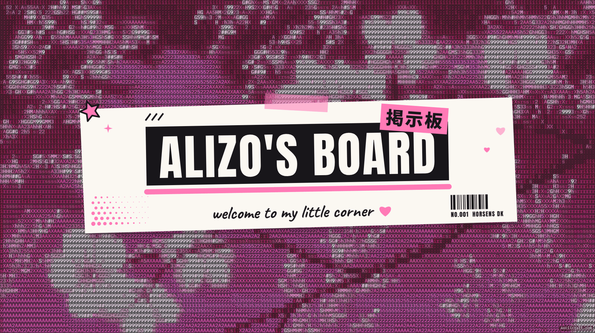


<a href="https://alextudev.com"></a>


</div>


<!-- ───────── ABOUT ───────── -->
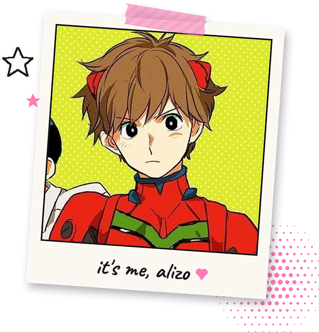


hi hi, i'm alizo <br/>
software engineering student by day, video editor by night.
i learn by doing and i teach what i learn.

```ts
// ~/about-me.ts
const alizo = {
  home:   "White Space",
  roles:  ["student engineer", "video editor"],
  games:  ["TLoU", "Deltarune"],
  motto:  "learn by doing, larp it 'til it's done",
};
```

<br clear="left" />


<!-- ───────── TECH STACK ───────── -->
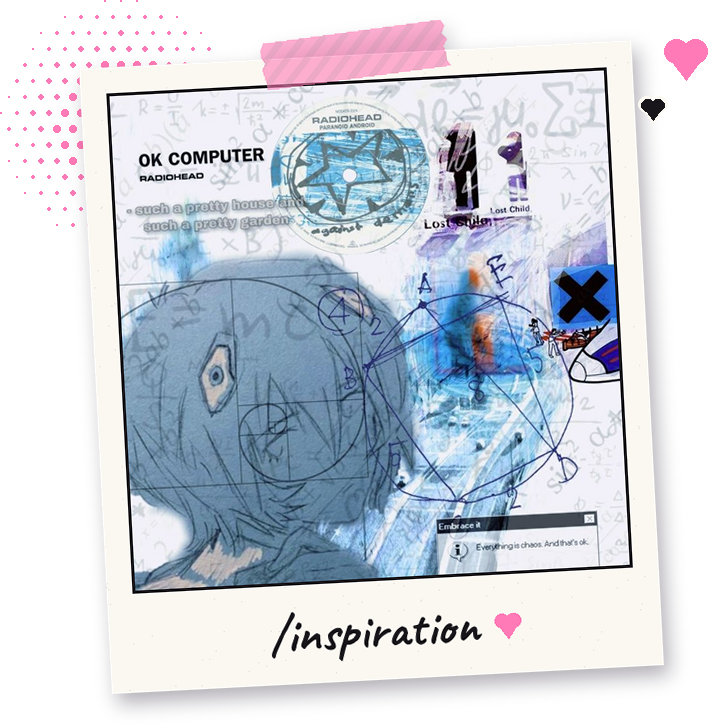


<sub><code>languages</code></sub><br/>


<sub><code>frameworks & tools</code></sub><br/>


<sub><code>creative</code></sub><br/>


<sub><code>also fluent in</code></sub> <br/>


<br clear="right" />


<!-- ───────── CLIPPINGS ───────── -->
<div align="center">

<br/>

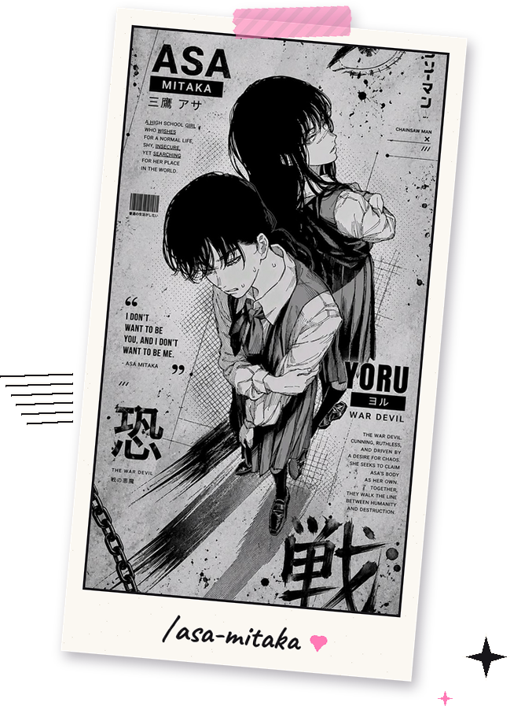
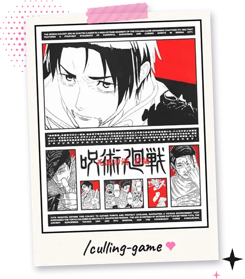
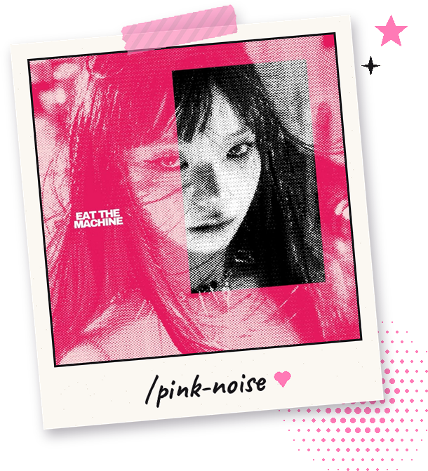

</div>


<!-- ───────── NOW PLAYING ───────── -->
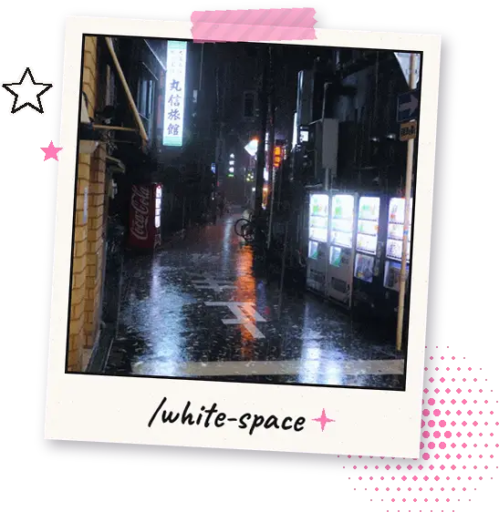

<br/>

<a href="https://open.spotify.com/user/87qy9a329m180u3oomp1am55e">

</a><br/>


<br clear="left" />


<!-- ───────── ACHIEVEMENTS + LANGUAGES ───────── -->
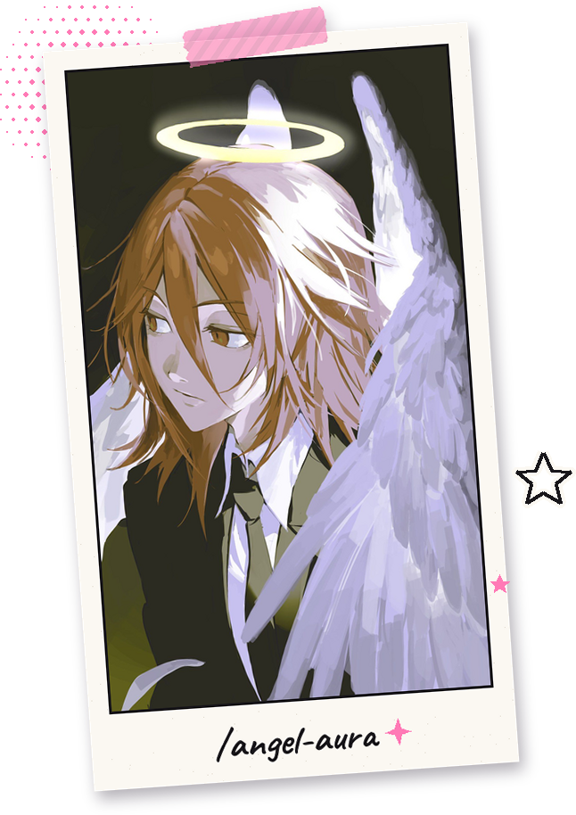


♡ **triple certiport** · python, databases & device config<br/>
♡ **robotics sensei** · 2 years teaching IT & robotics<br/>
♡ **timeline wizard** · freelance edits in after effects<br/>
♡ **scrum master** · kept our projects from crashing into deadlines<br/>
♡ **arduino whisperer** · taught embedded systems at ROBOCODE<br/>
♡ **query slinger** · postgresql certified


```
RO  ★ ★ ★ ★ ★   native
EN  ★ ★ ★ ★ ★   fluent
FR  ★ ★ ★ ☆ ☆   intermediate
RU  ★ ★ ★ ☆ ☆   intermediate
DA  ★ ☆ ☆ ☆ ☆   beginner (loading...)
```

<br clear="right" />


<!-- ───────── STATS ───────── -->
<div align="center">

<br/>


</div>


<!-- ───────── SAY HI ───────── -->
<div align="center">


always happy to collab, or to just chat 

<a href="mailto:alexturcanu03@gmail.com"></a>
<a href="https://www.linkedin.com/in/alexandru-turcanu-377642295"></a>
<a href="https://alextudev.com"></a>

<br/><br/>

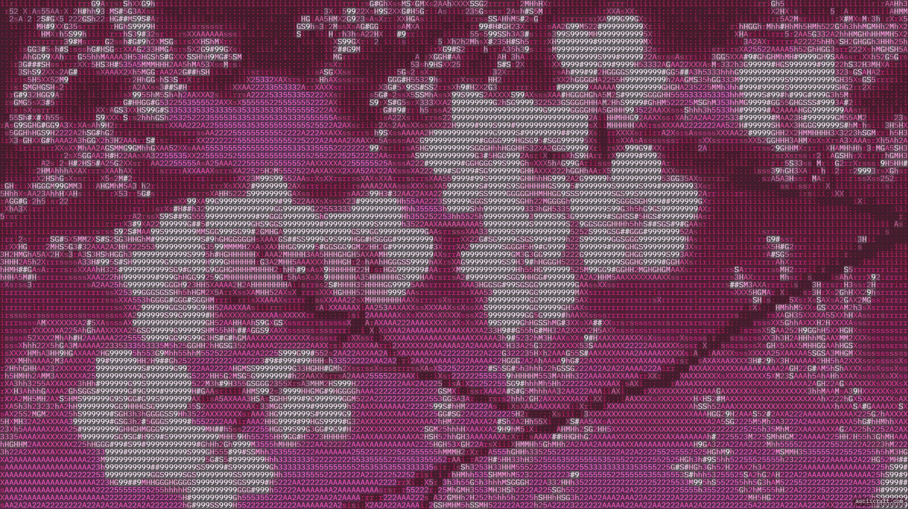

</div>
